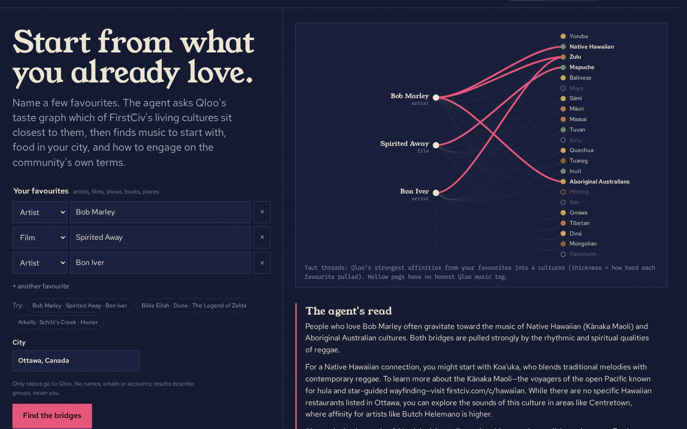

# FirstCiv Culture Agent

**Start from what you already love.** An agent that uses [Qloo](https://www.qloo.com)'s taste graph to build
bridges from a person's (or an audience's) favourite artists, films, shows and books to **living cultural
heritage** from the [FirstCiv](https://firstciv.com) archive — then finds music to start with, food in
your city, the part of town where that taste already lives, and how to engage on the community's own terms.

Live demo: **https://firstciv-agent.apps.mmix.biz** (no login).

Two modes:

- **For me** — name 1–6 favourites; the agent ranks 22 living cultures by Qloo affinity, explains which
  favourite pulled hardest toward each, and adds listening starts, nearby food and a respect note.
- **For my event** — a community organizer describes the audience (city, age group, what they already love);
  the agent ranks cultures *for that audience*, orders a lineup with `qloo_rank`, finds food partners and
  maps where the taste clusters in the city with `qloo_where_popular`, then adds a consent checklist.



## How it works

```
browser ──POST /api/run──▶ Node server ──▶ agent loop (LLM tool calling, OpenAI-compatible API)
   ▲   ◀── SSE: steps, Qloo traces, data ──┘        │
   │                                                ▼
   └─ string-figure board, bridge rows, map     7 tools ──▶ `qloo mcp` (official @qloo/qloo-harness, stdio)
                                                   │            qloo_describe · qloo_find_tags · qloo_recommend
                                                   │            qloo_rank · qloo_where_popular
                                                   └──────▶ FirstCiv culture records (data/cultures.json)
```

| Agent tool | Qloo workflow(s) | What it adds |
| --- | --- | --- |
| `resolve_tastes` | `qloo_describe` | Turns names into Qloo entity IDs; surfaces ambiguity instead of guessing |
| `find_concept_tags` | `qloo_find_tags` | Abstract tastes ("melancholic folk") → tag URNs |
| `find_culture_bridges` | `qloo_recommend` ×17 (one per culture, `include_tags` = that culture's music tags, `explain=true`) | Ranks cultures by affinity; per-signal explainability tells *which* favourite pulled |
| `culture_details` | — | FirstCiv's consent-first record and "how to support" guidance |
| `local_places` | `qloo_recommend` (`target_type=place`, cuisine tags, `filter_location`) | Food in the user's city, labelled as regional cuisine |
| `taste_map` | `qloo_where_popular` (+ OpenStreetMap reverse geocoding for area names) | Where in the city the bridge artist's affinity clusters |
| `rank_for_audience` | `qloo_rank` (options = the culture's artists, `demographic` + `signal_location` + audience signals) | Lineup / playlist order for an audience |

The model only plans and writes; every fact on screen comes from a tool result. If the model is unavailable,
a deterministic planner runs the same tools in the same order, so the demo never dead-ends. The left-hand
**Field notes** panel shows every tool step and every Qloo call with its endpoint, status, latency and cache hit.

### Culture profiles

`data/cultures.json` is built offline in two steps and committed:

1. `scripts/extract-firstciv.mjs` pulls the 22 cultures from FirstCiv (no statistics, no contributor handles).
2. `scripts/discover-tags.mjs` searches Qloo's tag ontology per culture; a human picked the tags that honestly
   name each tradition (`data/culture-tags.json`). `scripts/build-profiles.mjs` then fetches anchor artists.

Five cultures (Ainu, Hmong, Maya, San, Yanomami) have **no** Qloo music tag that names their tradition
without pulling in unrelated artists, so the agent shows them as hollow pegs and never invents a bridge.
"Mongolian barbecue" is deliberately not used as Mongolian food.

## Run it

Requirements: Node.js ≥ 22.19 (the Qloo harness requires it), a Qloo hackathon API key, and optionally any
OpenAI-compatible chat endpoint with tool calling (we use Ollama Cloud's `gemma4:31b` → `gpt-oss:120b`).

```sh
git clone https://github.com/ctmakc/firstciv-qloo-agent && cd firstciv-qloo-agent
npm ci
cp .env.example .env    # fill in QLOO_API_KEY (+ AI_API_KEY if you want the LLM planner)
npm run dev             # http://localhost:8795
```

Terminal only: `node --env-file=.env scripts/cli.mjs explorer "Bob Marley:artist" "Spirited Away:movie"`.

Docker: `docker build -t culture-agent . && docker run -p 3000:3000 --env-file .env culture-agent`.

Without `AI_API_KEY` the deterministic planner runs the full plan and writes a templated summary.

## Responsible use

- Only tastes are sent to Qloo. Inputs containing emails or phone numbers are rejected server-side.
- Copy always describes groups ("people who love X also gravitate to Y"), never an individual.
- Regional cuisine is labelled as regional; a national cuisine is not an Indigenous people's own food.
- Every culture links to its FirstCiv record and its own guidance on respectful engagement; the agent is told
  never to suggest sacred or ceremonial material as entertainment.
- The Qloo key stays server-side in the process environment; the browser only talks to `/api/*`.
- Per-IP rate limits, a concurrency cap, bounded retries on Qloo 429s and a 72-hour response cache protect
  the event quota.

## Known limitations

- Qloo's genre tags for some regions mix in unrelated artists; "tag scope" is shown on every bridge and the
  agent is instructed not to claim an artist's membership of a people.
- Affinity scores from separate Qloo calls are only roughly comparable; the ranking is a starting point.
- Place data is sparse for small cuisines in mid-size cities (e.g. one Peruvian restaurant in Ottawa).
- The LLM's prose is constrained but not verified sentence by sentence; the structured rows below it are
  the ground truth.

## License

MIT — see [LICENSE](LICENSE). The culture texts in `data/` come from the FirstCiv archive, run by the
same team; the communities remain the owners of their heritage.
